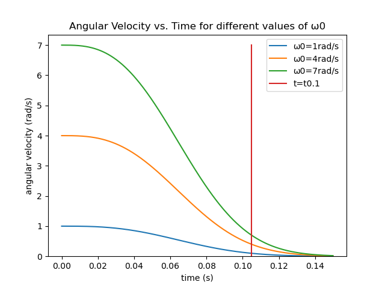
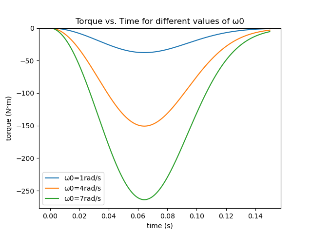
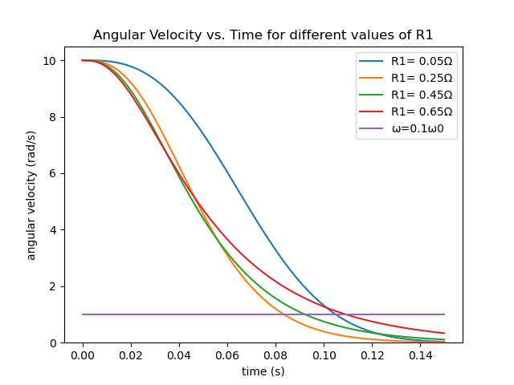
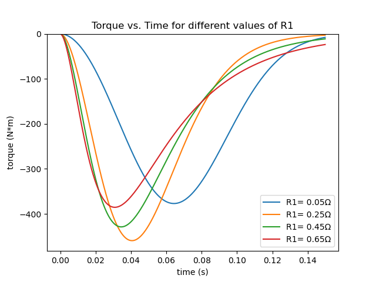

# eddy-current-brakes
Eddy current brakes are an alternative technology to friction brakes that use principles of electromagnetism to slow objects down which can be applied to certain scenarios in the real world. We will compare friction brakes and eddy current brakes, and test different combinations of different initial parameters.

**[Report (PDF)](docs/eddy_current_brakes_report.pdf)**

## Results

### Changing Initial Angular Velocity
| Angular Velocity vs. Time | Torque vs. Time |
|:--:|:--:|
|  |  |

### Changing Resistance
| Angular Velocity vs. Time | Torque vs. Time |
|:--:|:--:|
|  |  |

## Layout
```
eddy-current-brakes/
├── README.md
├── docs/
│   ├── figures/
│   ├── eddy_current_brakes_report.pdf
└── eddy_current_simulation.ipynb
```

## References
Full citations are in the report. Main sources: Gay & Ehsani (2006), *IEEE Trans. Magnetics*; Karakoc et al. (2016), *Applied Mathematical Modelling*; Halliday, Resnick & Krane, *Physics*, Part 2.
